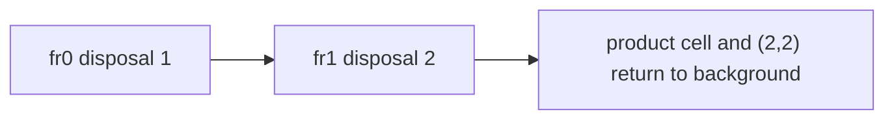

# `.fig`

A `.fig` file is a linked ObjectGraph whose samples live in one Z-ordered integer lattice, from a bond length to a body length, with frame timing borrowed from GIF. The sample bytes are a headerless record stream, and the CID of those bytes is the identity an HTTP response or a chain entry has to match. [SYNTH-FIG-0001](examples/synth-0001.fig) is an invented 4×4 lattice for checking the rules. It is not a scan and not a crystal.

```toml
[fig]
media_type = "text/vnd.fig+objectgraph"
field_type = "application/vnd.fig-field"
extension  = ".fig"
version    = "1.0.0"

[pipeline]
input   = "biomedical samples --lattice"
process = "z-order finite field { GIF time, HTTP CID }"
output  = "coordinate object --fileformat .fig { SUPERSEDES dicom-pixel-coordinate, cif-atom-site-coordinate }"
```

The two media types are vendor identifiers for this specification. They are not IANA registrations.

## 1. Axioms

1. **ObjectGraph.** The link document is Markdown with `::node` blocks. `::dense` is the intermediate summary. The terminal object is the field byte string.
2. **Headerless field.** Byte 0 of a field is the low byte of its first record. Bit depth, quantum, origin, and alphabet are attributes of linked nodes.
3. **Content address.** The field CID is CIDv1 raw SHA-256 of the canonical record bytes. The figure CID is CIDv1 raw SHA-256 of the published link-document bytes. A locator is an HTTP URL. The bytes it returns have to match the CID written on the node.
4. **One lattice.** Every spatial axis shares a bit depth `b`. Axis 0 occupies the least significant bit of each Morton group. The code does not carry a unit. The quantum is a positive rational on the lattice node.
5. **Scale.** Discarding `k` bit-planes from every axis yields the Morton code at quantum `q * 2^k`. The same encoder accepts a 154 pm bond and a 1.8 m body on a 48-bit axis whose quantum is 1 pm.
6. **Finite raw word.** A sample is a fixed-width byte string. The default alphabet is one element of GF(2^8) under the AES polynomial, and the byte is the element. Field addition is XOR. An integer rescale affine is a separate reading of the same byte.
7. **GIF time.** Delay, disposal, transparency, user input, and loop count use the GIF integers named in §7. The field is not a GIF file.
8. **Payload supersession.** A lattice cell plus a raw word replaces the DICOM pixel coordinate (image position, orientation, spacing, rescale) and the CIF atom-site coordinate (fractional site and cell). The rest of either format stays where it is.

## 2. Disclaimer

Clinical use is outside this format. See [DISCLAIMER](DISCLAIMER).

## 3. Ontology

| Node | Role | Required attributes |
|---|---|---|
| `figure` | Root | `loop`, `background`. Optional `time-num`, `time-den` (default `1`, `100`) |
| `lattice` | Finite address space | `bits`, `dims`, `axes`, `quantum-num`, `quantum-den` |
| `alphabet` | Sample word | `name` (`gf2-8` or `raw`), `value-bytes`. `gf2-8` also requires `irreducible=283` |
| `frame` | One GIF graphic | `seq`, `delay`, `disposal`, `user-input`. Optional `transparent` |
| `field` | Headerless records | `cid`. Inline `hex` fence, or a remote body with the same CID |
| `embedding` | Adapter into the lattice | `kind` (`dicom` or `cif`) |
| `meta` | `__view`, `__changelog` | — |

| Edge | Role |
|---|---|
| `:contains` | Child. A frame contains exactly one field |
| `:precedes` | Next frame. The order agrees with `seq` = 0..n−1 |
| `:supersedes` | Coordinate payload this object replaces |

`axes` is a comma-separated list whose length is `dims`. Omitted origin components are `0/1`. Quantum is `quantum-num / quantum-den` metres per least significant bit. Time quantum is `time-num / time-den` seconds. The default time quantum is 1/100 s, so a GIF delay integer copies unchanged.

## 4. Coordinate algebra

Let each axis coordinate `x_i` lie in `0 .. 2^b - 1`. The Morton code is

```text
code = Σ_k Σ_i  bit_k(x_i) · 2^(k·d + i)
```

with `k` from 0 to `b-1` and `i` from 0 to `d-1`. Interleaving is a permutation of the `d·b` bits, so it is a linear automorphism of the vector space (GF(2))^(d·b). The packed integer lies in the ring Z/2^(d·b) Z. That ring is a field only for width 1. Field arithmetic belongs to the sample alphabet.

The cell of coordinate `x_i` is the half-open interval `[o_i + x_i·q, o_i + (x_i+1)·q)`. Coarsening by `k` levels replaces `code` with `code >> (k·d)` and `q` with `q·2^k`. An aligned block of side `2^k` occupies `2^(k·d)` contiguous codes.

`d·b` is at most 256. `code_bytes = ceil(d·b / 8)`.

Hand check, `d=2`, `b=2`. Axis 0 is `x`.

| y\x | 0 | 1 | 2 | 3 |
|---|---|---|---|---|
| 0 | 0 | 1 | 4 | 5 |
| 1 | 2 | 3 | 6 | 7 |
| 2 | 8 | 9 | 12 | 13 |
| 3 | 10 | 11 | 14 | 15 |

The block `(2,2), (3,2), (2,3), (3,3)` is the contiguous range 12..15. `encode(3,2) = 13`. One coarsening level is `13 >> 2 = 3`, which is `encode(1,1)`.

Three low bits, `b=1`: `(1,0,0) → 1`, `(0,1,0) → 2`, `(0,0,1) → 4`.

At quantum 1 pm a 48-bit axis spans `2^48` pm = 281.474976710656 m. Coordinate 154 (a carbon–carbon scale length) and coordinate 1 800 000 000 000 (1.8 m) both fit. The body coordinate is greater than or equal to `2^40` and less than `2^41`. Dropping 10 planes puts 154 pm into coarse cell 0, whose width is 1024 pm.

Default alphabet `gf2-8`: one byte, polynomial `x^8 + x^4 + x^3 + x + 1` (integer 283, the AES polynomial). Addition is XOR. Multiplication of the bytes `0x57` and `0x83` is `0xC1`. Their field sum is `0xD4`. Their integer sum is `0xDA`. A figure may store any of these words. Only the field operations are the alphabet. Alphabet `raw` is an opaque little-endian word of `value-bytes` bytes and has no polynomial. DICOM rescale, `slope · word + intercept`, reads the little-endian integer. Stored bytes `90 01` are the integer 400. With slope 1 and intercept −1024 the affine value is −624.

## 5. Grammar

```ebnf
fig        = { meta_block | node_block | prose } ;
meta_block = "::meta" , NL , { kv } , "::end" , NL
           | "::schema" , NL , { kv } , "::end" , NL
           | "::index" , NL , { index_row } , "::end" , NL ;
node_block = "::node" , WS , "[" , attr , { WS , attr } , "]" , NL ,
             { "::dense" , WS , TEXT , NL | edge | fence } ,
             "::end" , NL ;
attr       = key , "=" , ( STRING | token ) ;
edge       = "->[" , ":" , edge_type , "]" , WS , target , { "," , WS , target } , NL ;
edge_type  = "contains" | "precedes" | "supersedes" ;
fence      = "```hex" , NL , { HEX , NL } , "```" , NL
           | "```mermaid" , NL , verbatim , "```" , NL ;
target     = id ;
key        = ( LETTER | "_" ) , { LETTER | DIGIT | "_" | "-" } ;
```

A line that begins with `->` and does not match `edge` is non-conformant. `seq` on the frames is exactly `0 .. n-1`. One figure node, one lattice node, and one alphabet node.

## 6. Headerless field and content address

A record is `le(code, code_bytes) || word`. Records are sorted by the integer code, strictly increasing. Duplicate codes are non-conformant. An empty field is the empty byte string. Little-endian byte order is not integer order: code 1 then code 256, with one-byte words `aa` and `bb`, is the byte string `01 00 aa 00 01 bb`. The byte-sorted permutation of that string is a different file and the strict reader rejects it.

A missing code has no record and no byte offset. Absence, the background word, and a transparent word are three different states. They coincide only when the figure chooses the same byte string for two of them.

The field CID is multibase base32 (prefix `b`, no padding) of the CIDv1 bytes `01 55 12 20 || SHA-256(field)`. `0x55` is multicodec raw. `0x12 0x20` is multihash SHA-256. The empty field CID is `bafkreihdwdcefgh4dqkjv67uzcmw7ojee6xedzdetojuzjevtenxquvyku`. The CID of the bytes `hello` is `bafkreibm6jg3ux5qumhcn2b3flc3tyu6dmlb4xa7u5bf44yegnrjhc4yeq`.

An HTTP GET of a field URL returns the canonical bytes and nothing else. The client checks the CID. A sample may be named `{field-url}/{code-hex}`, which is a name for the record a binary search finds. The hex code is not a byte offset.

Chunked transport may publish an RFC 6962 Merkle root: the leaf hash is SHA-256(`0x00 || chunk`) and the parent hash is SHA-256(`0x01 || left || right`), splitting each list at the largest power of two strictly below its length. The root depends on the chunk size. The field CID does not. The value recorded as the identity is the field CID. The figure CID is the CID of the link document as published. That document names each field CID and does not contain its own figure CID.

No account, transfer, or royalty rule is part of the format. A chain that wants a token identifier stores the CID.

## 7. Time

The integers are the GIF89a graphic-control values, widened from 16 bits where a biomedical clock needs it, plus the Netscape 2.0 loop count.

| Attribute | Borrowed meaning | Rule in `.fig` |
|---|---|---|
| `delay` | Hundredths of a second after the graphic is drawn | Non-negative count of time quanta. `0` is zero quanta |
| `disposal` 0 | Unspecified | Defined as disposal 1, so the next canvas is a function |
| `disposal` 1 | Leave in place | Canvas unchanged after the hold |
| `disposal` 2 | Restore the graphic area to the background | Every stored code, including transparent words, returns to background. A declared region returns every canvas cell inside it |
| `disposal` 3 | Restore what the graphic overwrote | Only non-transparent stored samples return to the previous word |
| `transparent` | Colour index that does not draw | Raw word that does not draw. The code stays in the graphic area |
| `user-input` 1 | Wait for an external event | An autonomous player stops. It does not invent the event |
| `loop` | Netscape iteration count. `0` means forever | Positive `N` plays the frame list `N` times. `0` is unbounded and the player supplies a finite cap |

Drawing order for each frame: draw every non-transparent sample, hold for `delay`, then dispose. The canvas is a total function. A cell with no entry displays `background`. Writing the background word clears the entry. The reference checker returns the visible canvas and the rested canvas. It does not sleep.

A region is a product of half-open axis intervals. A stored sample outside its region is non-conformant. With no region, the graphic area is the set of stored codes, which is the sparse reading of a GIF image rectangle.

## 8. Embeddings

Both embeddings quantize onto the lattice with round-half-away-from-zero. A result outside `0 .. 2^b - 1` is outside the lattice. Two source positions that land on one cell make the figure non-conformant at that quantum.

**DICOM.** Image Position (Patient) is the centre of the voxel at column 0, row 0, slice 0. The first three orientation cosines are the direction of increasing column. The next three are the direction of increasing row. Spacing is already split into column, row, and slice millimetres. Directions are used as given.

```text
P_mm = IPP + column·column_spacing·column_direction
           + row·row_spacing·row_direction
           + slice·slice_spacing·slice_direction
cell = round_half_away( (P_mm / 1000 − origin) / quantum )
```

At a 1 mm quantum, column spacing 2 mm puts column 1 on cell x=2, and row spacing 5 mm puts row 1 on cell y=5. An image position of 1.5 mm rounds to cell 2. An image position of −10 mm with origin 0 is outside the lattice. The same position with origin −10 mm is cell 0. A 10 mm quantum merges columns 0 and 1 when the spacing is 1 mm.

**CIF.** Fractional coordinates are wrapped into `[0, 1)` first, so a site at 1 is the site at 0. Orthogonal cells (angles 90°) stay in exact rationals. Any other cell uses the PDB orthogonalization in IEEE-754 binary64, then the same rounding. Angles are alpha, beta, gamma.

```text
X = a·xf + b·cos γ·yf + c·cos β·zf
Y = b·sin γ·yf + c·(cos α − cos β·cos γ)/sin γ · zf
Z = c·sqrt(1 − cos²α − cos²β − cos²γ + 2·cos α·cos β·cos γ) / sin γ · zf
```

Lengths are ångströms. Metres are those lengths times `10^−10`. A fractional site `(1/2, 1/5, 0)` in a 10 Å cube at quantum 1 Å is cell `(5, 2, 0)`. A half-step of 2.5 Å rounds away from zero to 3. A site at fractional −1/5 wraps to 4/5 and, on a 10 Å edge, is cell 8.

Conformance vector CIF-G60: lengths 2 Å, angles `(90°, 90°, 60°)`, fractional site `(0, 1/2, 0)`, quantum 1 pm, cell `(50, 87, 0)`. The y coordinate is `50·sqrt(3)` pm, and 87 is the nearer integer. The site `(0, 1, 0)` wraps to the origin. v1 does not expand space-group symmetry and does not repair a degenerate cell.

## 9. Canonical instantiation

[examples/synth-0001.fig](examples/synth-0001.fig) is SYNTH-FIG-0001. Its figure CID, the CID of those exact bytes, is `bafkreiaepsawnn22btbfh7a4cxyx372vwmvnsmjzazsvptfs4z7hnqas4u`.

The lattice is 2 bits by 2 axes, so each axis has cells 0..3. Quantum is 1/10 000 000 000 metre (1 Å). Alphabet is `gf2-8`. Background is `00`. Loop is 1. Time quantum is the default centisecond.

| Cell | Code | Word | Reading |
|---|---|---|---|
| (0,0) | 0 | `57` | factor |
| (1,0) | 1 | `83` | factor |
| (0,1) | 2 | `d4` | field sum |
| (1,1) | 3 | `c1` | field product |

Field `fld0` is the eight bytes `0057018302d403c1`. Its CID is `bafkreicefv34tw7gjhd5hikg2tuvg62l3kuzjzpthraj2fnizxgu4gtdcq`. Frame `fr0` holds for 10 quanta and leaves the graphic in place.

Field `fld1` is the four bytes `03000c11`: code 3 stores the transparent word `00`, and code 12 `(2,2)` stores `11`. Its CID is `bafkreicyel4mobw7ofnc7w4awt74xldi2md5cac6l64heqq3u73s2rad4y`. Frame `fr1` holds for 5 quanta. While it is visible the product cell still shows `c1` and `(2,2)` shows `11`. Disposal 2 then clears both stored cells. The field-sum cell `d4` remains.



The link document also carries a `dicom` embedding node and a `cif` embedding node, and a `:supersedes` edge to `dicom-pixel-coordinate` and `cif-atom-site-coordinate`. Those nodes name the adapters in §8. They do not claim that the 4×4 lattice is a reconstructed scan.

## 10. Algorithm

| Kind | Quantity |
|---|---|
| Independent | Samples, quantum, origin, frame list, alphabet |
| Dependent | Morton code, canonical bytes, CID, visible canvas |
| Controlled | Bit depth, dimension, little-endian width, integer sort, GIF disposal table |

| Process | Rule |
|---|---|
| Design | Choose `b` so every source position lands in range and no two positions share a cell |
| Transport | GET the URL and require the declared CID |
| Search | Binary search on the integer code |
| Filter | Drop transparent words on draw. Reject codes outside the lattice or the region |
| Stopping | Play `loop` times. An unbounded loop stops at the caller's cap |
| Recovery | Apply disposal after the hold |

## 11. Indications and contraindications

The format is for an agent that needs one address space for a molecular site and an anatomical voxel, a sparse sample set, a short frame list, and a content address it can fetch over HTTP or record on a chain.

The following are outside v1. A patient identifier has no field; prose that adds one is non-conformant. A `.fig` field does not become a DICOM object, a CIF dictionary, or a GIF by wrapping it in that format's signature. Float samples are not a stored word. Disposal 0 is specified, where GIF89a leaves it open. The Netscape loop integer is a play count, where some decoders treat it as extra repeats. Non-orthogonal cells follow the binary64 vector in §8. Symmetry copies are a caller's input, not a generated orbit. A quantum coarser than the source spacing can collide and then the embedding is rejected. The reference reader checks inlined hex. It does not open a socket.

## 12. Falsification

```text
PYTHONPATH=reference python3 -m unittest reference.test_fig
```

The checker tries to break the hand table, aligned-block contiguity, prefix coarsening, the 154 pm and 1.8 m span, the little-endian sort trap, the empty and `hello` CIDs, the AES product, both disposal rules, the DICOM half-millimetre and the negative origin, the orthogonal CIF cell, vector CIF-G60, and the byte identity of [examples/synth-0001.fig](examples/synth-0001.fig). This file pins the empty CID, the `hello` CID, both field CIDs, the figure CID, and both field hex strings. A drift between the prose and the bytes fails that test.

Neighbour files:

- [DISCLAIMER](DISCLAIMER)
- [fig.md](fig.md)
- [examples/synth-0001.fig](examples/synth-0001.fig)
- [reference/test_fig.py](reference/test_fig.py)
- [reference/figlib/zorder.py](reference/figlib/zorder.py)
- [reference/figlib/field.py](reference/figlib/field.py)
- [reference/figlib/gf.py](reference/figlib/gf.py)
- [reference/figlib/compose.py](reference/figlib/compose.py)
- [reference/figlib/embed.py](reference/figlib/embed.py)
- [reference/figlib/link.py](reference/figlib/link.py)

## References

1. G. M. Morton, *A computer oriented geodetic data base; and a new technique in file sequencing*, IBM Ltd., 1966.
2. *Graphics Interchange Format, version 89a*, §23 Graphic Control Extension.
3. Netscape Navigator 2.0 application extension, loop count. The block is not part of GIF89a. A count of 0 means unbounded.
4. National Institute of Standards and Technology, *FIPS 197, Advanced Encryption Standard*, 2001. GF(2^8) multiplication `{57} · {83} = {c1}`.
5. DICOM PS3.3, *Image Position (Patient)* and *Image Orientation (Patient)*, C.7.6.2.1.1. Pixel Spacing is row spacing then column spacing.
6. Protein Data Bank, atomic coordinate format, orthogonalization from fractional to Cartesian coordinates.
7. Multiformats CID, multicodec `raw` (`0x55`), multihash `sha2-256` (`0x12`).
8. RFC 6962, Certificate Transparency, Merkle hash-tree construction.
9. EIP-721. The token identifier and the token URI are the shape of the CID and the HTTP link. This format does not define a contract.
10. M. Dubey, *ObjectGraph* (`arXiv:2604.27820`), 2026.

## License

MIT. See [LICENSE](LICENSE).
